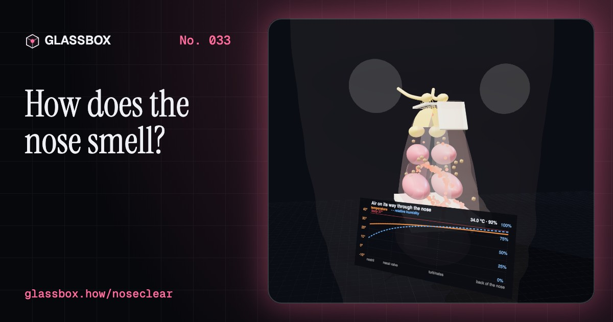
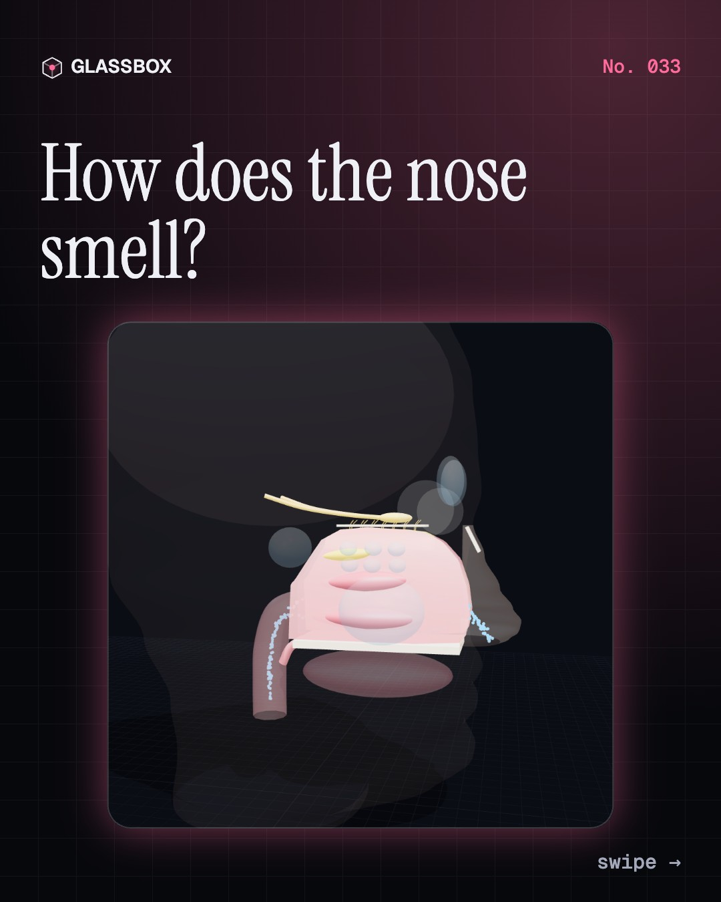
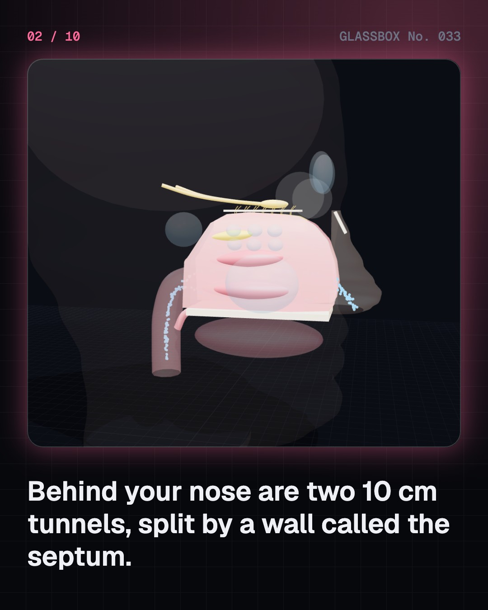
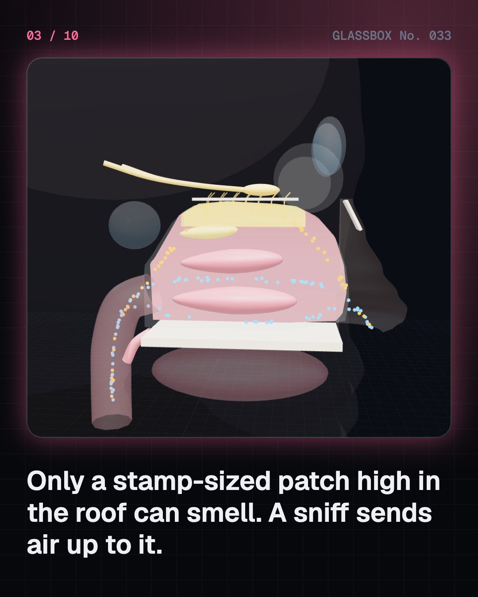
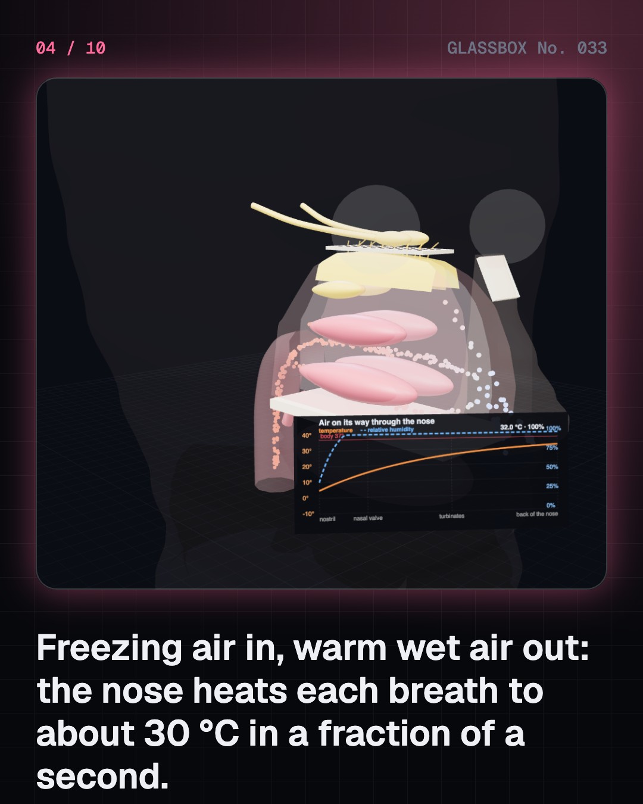

<!-- glassbox:start -->
<!-- Generated from glassbox.json by the Glassbox hub (npm run readme -- noseclear). Edit glassbox.json, not this block. -->
<p align="center"><a href="https://glassbox.how/e/noseclear/"></a></p>

<h1 align="center">NoseClear</h1>

<p align="center"><b>How does the nose smell?</b><br>Your nose is two 10 cm tunnels with a stamp-sized smell patch in the roof, about 400 kinds of receptor, and a direct line to the brain's memory centres. Sniff air up to the patch, watch molecules fit their receptors, and see why a mango is mostly smell.</p>

<p align="center"><a href="https://glassbox.how/noseclear/"><b>▶ Play with it</b></a> &nbsp;·&nbsp; <a href="https://glassbox.how/e/noseclear/">Read the 60-second explainer</a> &nbsp;·&nbsp; <a href="https://glassbox.how/noseclear/glassbox/reel.mp4">Watch the 40-second video</a></p>

<p align="center">
  <a href="https://glassbox.how/e/noseclear/"></a>
  <a href="https://glassbox.how/e/noseclear/"></a>
  <a href="LICENSE"></a>
  <a href="LICENSE-CONTENT.md"></a>
  <a href="#privacy"></a>
</p>

## In 60 seconds

1. **Two tunnels and a smell patch.** Behind your nostrils, two nasal cavities run about 10 cm back, split by the septum. Three curled turbinates hang from each side wall. Smelling happens only in a small yellowish patch in the roof, the olfactory epithelium, just under a sieve of bone called the cribriform plate. A sniff sends more air up to it.
2. **A built-in air conditioner.** The turbinates are warm, wet and full of blood vessels. Room air at about 25 °C reaches the back of the nose at about 34 °C and 90% humidity. Mucus traps dust and cilia slide it back to the throat, and in most people the two sides take turns to swell every few hours: the nasal cycle.
3. **About 400 locks, endless barcodes.** Smell molecules dissolve in the mucus and fit receptors on the cilia of millions of smell neurons. Humans have about 400 working receptor types, found by Linda Buck and Richard Axel in 1991. Each smell activates its own combination, like a barcode, so mirror-image molecules such as the two carvones can smell of spearmint and caraway.
4. **A short cut into the brain.** Neurons with the same receptor all wire to the same glomeruli in the olfactory bulb. From there, signals go straight to the piriform cortex, the amygdala and the gateway to the hippocampus, without the thalamus relay other senses use first. That is one reason smells bring back memories and feelings.
5. **Flavour is mostly smell.** The tongue senses five basic tastes. The rest of flavour is retronasal smell: aroma rising from the mouth up the back of the nose as you chew and breathe out. Hold your nose and a mango is just sweet and sour. Chilli heat and mint cool come through the trigeminal nerve, and steady smells fade within minutes.
6. **When smell goes wrong.** Colds block air from the smell patch, COVID-19 took smell from roughly 40 to 50% of patients early in the pandemic, and smell fades with age. Cooking gas gets a trace of ethyl mercaptan so leaks can be smelled at about a part per billion, long before the gas could burn. For your own nose, see a doctor.

## Words worth knowing

| Term | Meaning |
|---|---|
| **Olfactory epithelium** | The small patch of lining high in the roof of the nose that holds the smell neurons. |
| **Turbinates** | Three curled, lined shelves on each side wall of the nose that warm, wet and clean the air. |
| **Olfactory receptor** | A protein on a smell neuron's cilia that binds certain molecules. Humans have about 400 working types. |
| **Combinatorial code** | Each smell is recognised by the combination of receptor types it activates, like a barcode. |
| **Olfactory bulb** | The first stop for smell in the brain, where axons of one receptor type meet in the same glomeruli. |
| **Retronasal smell** | Smelling food from inside the mouth, as air rises up the back of the nose while you chew and breathe out. |
| **Nasal cycle** | The natural swapping of swelling between the two sides of the nose every few hours. |
| **Anosmia** | Loss of the sense of smell. |

## A short history

**4,000 years from Bronze Age perfume workshops to the genes for 400 smell receptors, a gas that was given a smell to save lives, and a virus that took smell from millions.**

- **1200 BCE** · Tapputi, the first named chemist (Tapputi-Belatekallim, Babylon, Mesopotamia (Iraq))
- **55 BCE** · Smells are made of shaped atoms (Lucretius, Rome)
- **1888** · The first olfactometer (Hendrik Zwaardemaker, Utrecht, Netherlands)
- **1937** · The school explosion that gave gas a smell (New London School, Texas, New London, Texas, USA)
- **1964** · Smell by shape: the lock-and-key idea (John Amoore, United Kingdom and United States)
- **1982** · The first electronic nose (Krishna Persaud and George Dodd, University of Warwick, UK)
- **1991** · The smell receptor genes are found (Linda Buck and Richard Axel, Columbia University, New York, USA)
- **2004** · A Nobel Prize for smell (Linda Buck and Richard Axel, Stockholm, Sweden)

The full story, with 26 moments, charts, people and 43 sources: [glassbox.how/e/noseclear/history](https://glassbox.how/e/noseclear/history/). The data lives in [`history.json`](history.json).

## Video and slides

Made with the Glassbox studio from this box's storyboard (`window.glassbox.director`). Free to reuse under CC BY 4.0.

<a href="https://glassbox.how/noseclear/glassbox/video.mp4"></a>

<p><a href="glassbox/slide-1.jpg"></a> <a href="glassbox/slide-2.jpg"></a> <a href="glassbox/slide-3.jpg"></a> <a href="glassbox/slide-4.jpg"></a></p>

| File | What | Size |
|---|---|---|
| [`glassbox/reel.mp4`](https://glassbox.how/noseclear/glassbox/reel.mp4) | Reel / Short, with captions and soundtrack | 1080×1920 |
| [`glassbox/video.mp4`](https://glassbox.how/noseclear/glassbox/video.mp4) | YouTube video, with captions and soundtrack | 1920×1080 |
| `glassbox/slide-1…10.jpg` | Instagram carousel | 1080×1350 |
| `glassbox/thumb.jpg` | YouTube thumbnail | 1280×720 |
| `glassbox/cover.jpg` | Share card and repo social preview | 1200×630 |
| [`glassbox/history-reel.mp4`](https://glassbox.how/noseclear/glassbox/history-reel.mp4) | “History in 10 moments” Reel / Short | 1080×1920 |
| `glassbox/history-slide-*.jpg` | History carousel | 1080×1350 |
| `glassbox/post.json` | Post copy and schedule used by the publish kit | |

## Privacy

This box has no accounts and no ads, and it ships its own fonts and libraries. When you run it yourself it sends nothing anywhere. On glassbox.how, the site's `/bar.js` also loads Glassbox's analytics: **Google Analytics** to count visits (it asks first in the EU, UK and Switzerland, and stays off when your browser sends Global Privacy Control or Do Not Track) and **ClickTrust** to detect bots.

It remembers a few things **in your own browser only**, and never sends them anywhere:

| Browser storage key | What it holds |
|---|---|
| `noseclear.v1` | Which chapters you have opened, your best quiz scores, and sound on or off. |

Exactly what each one sees is at [glassbox.how/privacy](https://glassbox.how/privacy/).

## Licences

- **Code:** [MIT](LICENSE). Use it, change it, ship it.
- **Explanations, text, images and videos** (`glassbox.json`, `glassbox/`): [CC BY 4.0](LICENSE-CONTENT.md). Credit “Glassbox, glassbox.how/e/noseclear”.
- **Third-party parts** keep their own licences: [three.js](https://threejs.org) (MIT), [Geist, Instrument Serif](https://openfontlicense.org) (SIL OFL 1.1).
- The Glassbox name and logo aren't covered by either licence. See the [terms](https://glassbox.how/terms/).

Found a mistake? [Open an issue](https://github.com/bdeeps/noseclear/issues). Corrections happen in public.
<!-- glassbox:end -->

## Run it

It's plain HTML, CSS and JavaScript. No build step and no dependencies. Run locally, it contacts no other website.

```bash
python3 -m http.server 8000
```

Three.js and the fonts ship in `vendor/` and `fonts/`, so it also works offline.

Then open http://localhost:8000.

## How it's built

| File | What |
|---|---|
| `index.html`, `css/app.css` | The page and its styles |
| `js/app.js`, `js/stage.js`, `js/ui.js`, `js/kit.js` | The shared Glassbox 3D engine: chapters, 3D stage, controls, quiz, video director |
| `js/chapters/*.js` | One file per chapter: the 3D model, controls, text, key terms, quiz and video scenes |
| `js/nose.js` | The shared models: the 3D head, nose and nasal cavity (septum, turbinates, smell patch, cribriform plate, olfactory bulb, sinuses, nasopharynx), air streams through it, the nose's warming and humidifying model, odour molecules and their receptor patterns, with sources |
| `glassbox.json` | Title, question, explainer beats, key terms, browser storage and credits shown on glassbox.how |
| `reel` in each chapter | The storyboard the Glassbox studio records into short videos |
| `glassbox/` | The published video, slides, thumbnail and post copy |
| `fonts/`, `vendor/three/` | Self-hosted Geist and Instrument Serif (SIL OFL 1.1) and three.js (MIT) |
